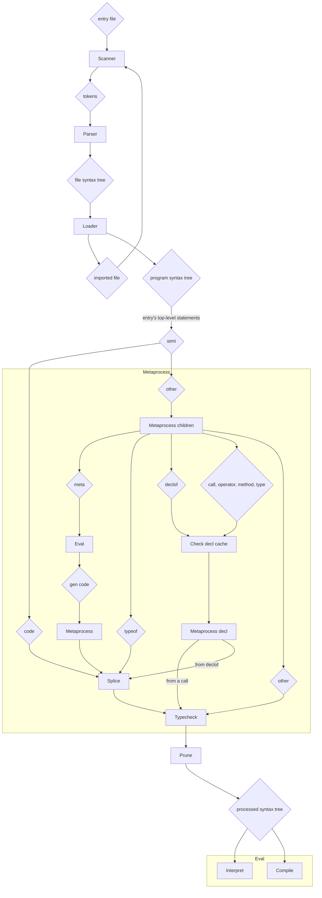

# Cronyx Phase Diagram



# Metaprocessing Truths
Metaprocessing is a complex recursive task, so I am going to list true statements about code that has been metaprocessed.
* Processed Code is type checked
* Processed Code does not contain `meta`
* Processed Code is monomorphized
* No Reflection Node

# Working Examples

```cronyx
effect Ask { ctl ask(): int; }

var ret = run {
    var n = ask();
    print(n);
    "hehe"
} handle Ask {
    ctl ask() {
        print("asked");
        var res = resume 5;
        print(res);
        return "complete";
    }
};
print(ret);
```

lets say run evaluates to `<Run>` and ask resumes with type `<Ask>`:
```
trait Ask {
	fn ask(): int;
}

var ret = run<String> {
	var n = ask(); 
	print(n);
	"hehe"
} handle<Ask> {
	fn ask(resume) {
		print("asked");
		var res = resume(5);
		print(res);
		return "complete";
	}
};

print(ret);
```
# EffectHandler
An effect is a trait written as its callers see it. An operation marked `@ctl`
takes control of the continuation; an unmarked one is tail-resumptive, and
returns exactly once whatever handles it.

```cronyx
trait Effect {
    fn log(msg: string): unit;
    @ctl fn choose(options: Array<int>): int;
}
```

A handler implements `EffectHandler<E, R>`, where `R` is what the run returns. It is
written in Cronyx, with a meta block that runs once per instance: each `@ctl`
operation of `E` gains a continuation as its last parameter and returns `R`,
and every other operation is kept as written.

```cronyx
import { DeclKind, MethodSig, Param, Signature, TypeExpr, TypeKind } from "std/compiler/Ast";

trait EffectHandler<E, R> {
    meta {
        match declof(E).kind {
            DeclKind.Trait(effect) => {
                for (op in effect.methods) {
                    gen handled(op);
                }
            }
            _ => { fail("not a trait, so it has no operations to handle"); }
        }
    }
}

fn takes_control(op: MethodSig): bool {
    for (a in op.attrs) {
        if (str(a.name) == "ctl") { return true; }
    }
    return false;
}

fn handled(op: MethodSig): MethodSig {
    if (!takes_control(op)) { return op; }

    var answer = TypeExpr.of(TypeKind.Named("R".as_name()));
    var resumes = TypeExpr.of(TypeKind.Named("unit".as_name()));
    match op.signature.ret {
        Option.Some(t) => { resumes = t; }
        _ => {}
    }

    var params: List<Param> = [];
    for (p in op.params) { params.push(p); }
    params.push(Param {
        name: "resume".as_name(),
        ty: Option.Some(TypeExpr.of(TypeKind.Function([resumes], answer, []))),
        implicit: false
    });

    return MethodSig {
        name: op.name,
        params: params,
        signature: Signature {
            ret: Option.Some(answer),
            row: Option.None,
            static_params: op.signature.static_params
        },
        attrs: op.attrs
    };
}
```

`EffectHandler<Effect, String>` is

```cronyx
trait EffectHandler<Effect, String> {
    fn log(msg: string): unit;
    fn choose(options: Array<int>, resume: (int) -> String): String;
}
```

and a handler is an ordinary impl of it:

```cronyx
type Picker impl EffectHandler<Effect, String> {
    fn log(msg: string): unit {
        print(msg);
    }
    fn choose(options: Array<int>, resume: (int) -> String): String {
        var last = "";
        for (x in options) { last = resume(x); }
        return last;
    }
}
```

In a `run`, `handle<E>` always implements `EffectHandler<E, R>`:

```cronyx
var ret = run<String> {
    log("picking");
    var n = choose([1, 2]);
    str(n)
} handle<Effect> {
    fn log(msg) { print(msg); }
    fn choose(options, k) {
        var last = "";
        for (x in options) { last = k(x); }
        return last;
    }
};
```

The continuation is the last parameter, and its name is free. An effect with no
`@ctl` operation is its own `EffectHandler`, so its handler implements the trait as
written. Only calls to a `@ctl` operation split their caller: a function that
calls `log` and never `choose` is not rewritten.

A handler's type is static: the run binds `{E = that type}`, so dispatch and
each operation's mode are decided at compile time. What a `handle` block reads
from around it is captured by reference, as a lambda captures, into a value of
that type, and every instance under the key takes the value as a parameter. A
handler that reads nothing has no fields, and the parameter disappears.

```cronyx
var out: List<string> = [];
run {
    greet("ada");
} handle<Console> {
    fn write(to, text) { out.push(text); }
}
```

A handler written once and reused is a named type. One for an effect with no
`@ctl` operation implements the trait itself and works under any run; one for
an effect with `@ctl` operations is generic over the run's type:

```cronyx
type BasicLog impl Log {
    fn log(msg: string) { print("From handler definition: " + msg); }
}

type Picker<R> impl EffectHandler<Effect, R> {
    fn log(msg: string) { print(msg); }
    fn choose(options: Array<int>, k: (int) -> R): R {
        var last = "";
        for (x in options) { last = k(x); }
        return last;
    }
}
```

A run binds every handler it is given, inline with `handle<E>` or named with
`with`, and `with H` binds every effect `H` handles that the body performs. Two
handlers claiming one effect in the same run is an error:

```cronyx
run<String> { ... } handle<Effect> { ... } with BasicLog;
run<String> { ... } with Picker;
```

`run` stays a keyword, with a fixed meaning the way `a + b` means `Add.add(a, b)`:
the body is quoted and handed to `effect_transform` with the run's handlers, and
what it returns is generated in place. The body as written never executes.

```cronyx
var ret = run<String> {
    var n = ask();
    print(n);
    "hehe"
} handle<Ask> { ... };
```

means

```cronyx
var ret = meta {
    gen effect_transform<Ask, __Handler>(code {
        var n = ask();
        print(n);
        "hehe"
    });
};
```

where `__Handler` is the type the `handle` block implements. With `Five` as that
handler, what runs is:

```cronyx
var ret = Five.ask((n) => {
    print(n);
    "hehe"
});
```

`effect_transform` is library code. It splits at each call to a `@ctl`
operation, passing the rest of the block as the continuation; a call to any
other operation becomes a direct call to its handler; a call to a function that
performs a handled effect is transformed the same way through `declof` and
generated under a new name. Nested runs transform from the inside out, and an
effect no handler claims is left for an outer run.

`effect_transform` keeps today's control flow across a split, and the fixtures
in `tests/effects` are its specification:

- A `return` after a split hands its value to the enclosing function's caller,
  from inside a loop (`return_in_converted_loop`) or from inside a run body,
  where it leaves the function the run is written in (`return_out_of_run`).
- A loop holding a split becomes recursion, and `break` and `continue` keep
  their meaning, through `match`, nested loops and `defer`
  (`break_in_converted_loop`, `continue_in_converted_loop`).
- A `while` condition holding a split is performed every iteration
  (`suspend_in_while_condition`).
- `&&` and `||` split only on the branch that reaches the operation
  (`suspend_in_logical`, `suspend_in_logical_nested`, `suspend_in_logical_while`).
- A split inside a field assignment or a variant's payload keeps evaluation
  order (`suspend_in_field_assign`, `suspend_in_variant`).
- A continuation's type carries the effects its run passes outward,
  `(A) -> <ρ> R`, so it is typed honestly where it is stored
  (`List<() -> <Error> unit>`), and calling it outside the runs that handle
  those effects is an unhandled effect. `abort_after_resumption` drains its
  stored continuations inside the `Error` run.
- A `defer` in an arm runs when the arm is unwound past, while the arm's code
  after the resume does not (`return_past_arm_defer`, `deferred/`,
  `discontinue/`).
- A run inside `if`, `match` or `while` (`nested_control/`).

`E` is not bounded: a static param has no way to say it is a trait. A type that
is not one fails in the meta block, at the instance that named it.

This needs a `meta` block in a trait body, `gen` of a method signature into it,
and `declof` of a static param, none of which exist yet.

# Splice
`gen` emits whatever code it is given and never fails. Splice replaces a node
with what stands for it, and it is Splice that knows the context: a `meta`
block standing as a statement takes any number of generated statements, and
one standing as an expression takes exactly one generated expression, which
replaces it. Code that does not fit where it lands is an error at Splice.

```
var x = meta { gen code(1 + 2); };
```

is `var x = 1 + 2;`.

`gen` of a call evaluates it when the callee returns syntax (`Expr`, `Stmt`,
`Decl`, `MethodSig`, `TypeExpr`, or a `List` of one) and emits the result;
any other call is emitted as written:

```
fn two(): Expr { return code(2); }
meta { gen two(); }
meta { gen print(1); }
```

# Expected Types
When Metaprocess children runs, it passes each child the type its parent
expects of it, if there is one. When that child reaches Typecheck, it checks
against the expected type if it has one, and on its own otherwise.

A child that gives the type is processed before the child that uses it:

```
var xs: Set<int> = [1, 2];
fn make(): Set<int> { return [1, 2]; }
fn takes(s: Set<int>) { }
takes([1, 2]);
Box { items: [1, 2] }
```

An expected type may hold a static param the call has not settled yet. The
known part is passed down with the unknown left open, and the child's own type
settles it:

```
fn takes_any<T>(s: Set<T>) { }
takes_any([1, 2]);
```

A generic function used as a value is an instance like any other, so its key
comes from the expected type or is written out. With nothing to settle it, the
key is not settled:

```
fn helper<T>(t: T): T { return t; }
var g: (int) -> int = helper;
var h = helper<int>;
var f = helper;
```

A parameter with no type written is an implicit static param, so its type is
part of the key: `fn id(x)` is `fn id<T>(x: T)`, and two calls at two types make
two instances. A lambda's parameters are not: a lambda is a value, and has one
type.

```
fn id(x) { return x; }
id(1);
id("a");
```

# Recursion
A call that reaches a declaration still being metaprocessed is checked against
its written signature. If the signature leaves a type to inference, inference
fails there, and writing the type fixes it:

```
fn is_even(n: int) { if (n == 0) { return true; } return is_odd(n - 1); }
fn is_odd(n: int)  { if (n == 0) { return false; } return is_even(n - 1); }
is_even(4);
```

# Non-termination
Metaprocessing that never finishes is user error, and the compiler does not
guard against it. A function that calls itself at a new key each time loops
forever, because every instance needs the next one:

```
fn nest<T>(t: T, n: int): int {
	if (n == 0) { return 0; }
	return nest([t], n - 1);   // {T = int} → {T = List<int>} → {T = List<List<int>>} → …
}
```

The same goes for a `meta` block that loops.

# Desugar and Resolve
Neither is a phase. Each of their jobs moves into one the diagram already has,
or stops existing.

`Desugar`:

- A C-style `for` becomes an initializer and a `while` in the Parser: it is
  purely syntactic, so the parser builds the `while` itself.
- A variadic call collects its trailing arguments in the call branch, which has
  the callee's declaration in hand at Check decl cache.
- Top-level statements are wrapped as `__root` where the program enters
  Metaprocess, the edge from the program syntax tree to `stmt`.

`Resolve`:

- Operators, indexing, compound assignment and collection literals are calls,
  and take the call branch: their children are typed, so the impl is chosen
  there and goes through Check decl cache, as a method call does.
- Impls are not flattened: each method instance is already its own entry in the
  decl cache.
- A coercion to a trait object is inserted by Typecheck and builds its table
  there, a record of that impl's method instances, so it reaches every method
  of the impl through the decl cache.

# Implementing Traits in the Type
A type can name the traits it implements in its own declaration, the way a Java or C# class lists
its interfaces. The body holds its fields, then the methods of every trait it names:

```
type Five impl EffectHandler<Ask, String> {
	fn ask(resume) {
		var s = resume(5);
		print(s);
		return "some string";
	}
}
```

is the same as the two declarations

```
type Five {}
impl EffectHandler<Ask, String> for Five {
	fn ask(resume) {
		var s = resume(5);
		print(s);
		return "some string";
	}
}
```

Several traits are separated by commas, and a type with fields and static params works the same way:

```
type Picker<R> impl EffectHandler<Choose, R>, Display {
	last: Int,
	fn choose(options, k) { return k(options[0]); }
	fn fmt(self): String { return "a picker"; }
}
```

Each method goes to the trait that declares it. A method no named trait declares belongs to the
type itself. A method name two of the named traits both declare is an error; that pair is written
as separate `impl` declarations.
